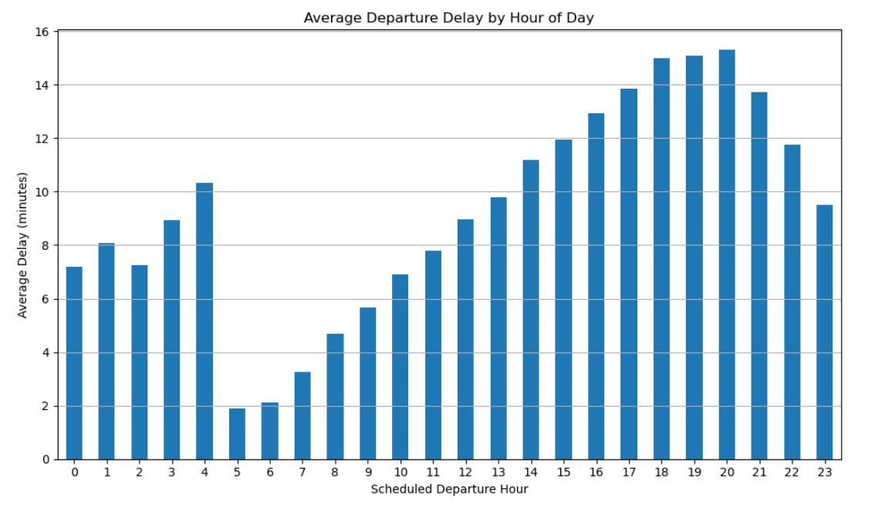
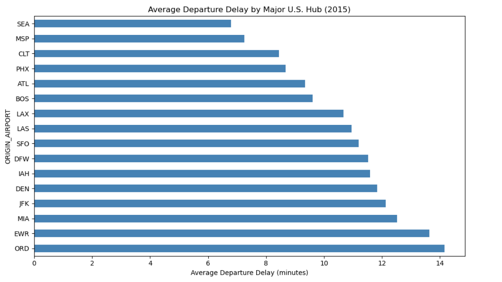
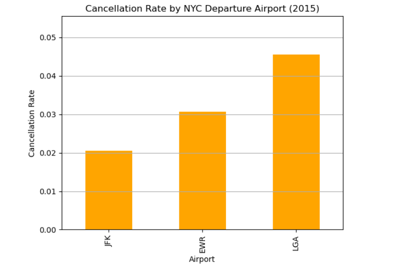

# Airline Delays and Cancellations (2015)

Analysis of a full year of U.S. domestic flights to find where, when and why the system breaks down: which causes drive delay, how delay builds through the day, which airports and routes cancel most, and how the major hubs compare.

**Tools:** Python (pandas, matplotlib), Jupyter Notebook, Git and GitHub

## Key Findings

- **Carrier delay is the largest source of delay minutes**, ahead of late arriving aircraft and NAS (air system) delay. The biggest share of lost time sits with factors airlines control directly.
- **Delay compounds through the day.** Average departure delay climbs steadily from the morning and peaks between 4 PM and 8 PM, as early disruptions ripple into later departures.
- **LaGuardia cancels far more than its neighbors.** LGA's cancellation rate was about 4.5%, against about 2% at JFK and about 3% at EWR, and most of the 15 most canceled routes touch LGA.
- **Cancellations peak in winter**, with February the worst month.
- **Hub performance varies widely.** Among major hubs, Seattle (SEA), Minneapolis (MSP) and Charlotte (CLT) performed best; Chicago O'Hare (ORD), Newark (EWR) and Miami (MIA) performed worst.

## What This Means for Operations

- **Protect the evening bank.** Because delay accumulates into the 4 PM to 8 PM window, schedule buffer and recovery resources do the most good there.
- **Watch the controllable causes first.** With carrier delay leading, turn times, crew availability and maintenance readiness are the first metrics worth tracking.
- **Plan winter protection for LGA.** LGA routes carry outsized cancellation risk, especially in winter, which argues for earlier proactive rebooking and spare capacity on those routes.
- **Benchmark the hubs carefully.** The gap between SEA, MSP and CLT and the weaker hubs is worth studying, keeping in mind that weather and airspace congestion explain part of it.

## Methodology

- Excluded early departures (negative delay values) from average delay calculations so they would not mask real delays.
- Separated low volume regional airports from major hubs. Small airports such as Aspen (ASE), Eagle-Vail (EGE) and Trenton (TTN) post extreme averages on very few flights, so hub comparisons use major airports only.
- Reviewed extreme outliers before aggregating.
- Grouped delays and cancellations by cause, hour of day, day of week, month, airport and route.

## More Charts

All charts are in [`/visuals`](visuals/), including:

- Cancellations by month and average arrival delay by month
- Delay heatmap by day of week and month
- Most delay prone, most canceled and most on time routes
- Most canceled routes at major hubs

## Files

- `Airline_Delay_Analysis.ipynb`: full analysis notebook
- `data/`: place the dataset here (not stored in the repo, see below)
- `visuals/`: exported charts
- `README.md`: this documentation

## How to Run

1. Clone this repository.
2. Download the 2015 U.S. DOT flight delays dataset and place `flights.csv` in `data/`. The file is about 590 MB, over GitHub's file size limit, so it is not included here.
3. Install the dependencies: `pip install pandas matplotlib jupyter`
4. Open `Airline_Delay_Analysis.ipynb` in Jupyter and run all cells.

## Future Extensions

- Power BI dashboard for stakeholder facing reporting
- Compare across multiple years
- Explore aircraft types and delay correlation
- Study route density and performance
